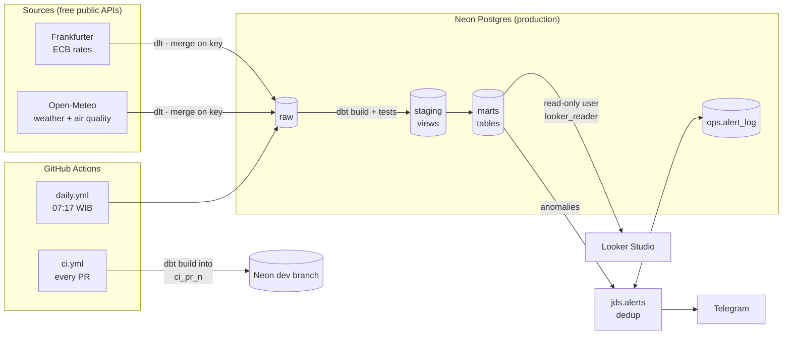

# Jakarta Daily Signals

[](https://github.com/Tedyhermawanto21/jakarta-daily-signals/actions/workflows/daily.yml)
[](https://github.com/Tedyhermawanto21/jakarta-daily-signals/actions/workflows/ci.yml)

A **serverless, zero-cost** daily data pipeline that tracks the USD/IDR exchange rate, weather and
air quality in Jakarta. Every morning it loads the data idempotently, transforms and tests it, and
sends a summary to Telegram, flagged with ⚠️ when the rate moves more than 1% or daily PM2.5
exceeds 55 µg/m³.

**📊 Public dashboard:** [Looker Studio · Jakarta Daily Signals](https://datastudio.google.com/reporting/218f441e-1252-4c35-bd68-23b86e2d57ea)


The dashboard and the Telegram message are in Indonesian because they are written for people in Jakarta.

---

## What it answers

| Question | Finding (23 Aug – 21 Nov 2026) |
|---|---|
| How is USD/IDR trending, and when did it move more than 1% in a day? | The rupiah weakened from ~17,700 to ~18,260. No day moved more than 1% (largest: +0.78%). |
| How many days per month is PM2.5 above 55 µg/m³? | August 1, September 2, **October 18**, November 11 (through the 21st). |
| At what hour is PM2.5 worst? | **06:00 WIB** (mean ~80 µg/m³), lowest around 16:00. |
| Are rainy or windy days cleaner? | Windy days: yes (correlation −0.37). Rainy days: **not shown** (+0.28), likely because rain tends to fall in the afternoon while pollution peaks in the morning. |
| What happened yesterday? | Scorecards and a status row, matching the morning Telegram message. |

## Architecture



**Daily run (about 2 minutes):** create schemas → ingest the last 7 days (dlt, `merge`) →
`dbt build` (models + tests) → `dbt source freshness` → Telegram summary (at most once per day,
deduplicated through `ops.alert_log`).

| Layer | Contents |
|---|---|
| `raw` | dlt tables `fx_rates`, `weather_daily`, `air_quality_hourly`, keyed by date or hour, so reruns overwrite instead of append. |
| `staging` | `stg_*` views (renamed and typed columns) and `int_*` views (daily FX change, daily PM2.5 from actual hours). |
| `marts` | `fct_daily_signals`, `fct_anomalies` (the anomaly rules), and small per-grain `dash_*` tables for the dashboard. |
| `ops` | `alert_log`: what has already been sent to Telegram. |

## Stack

| Part | Choice | Version (from `uv.lock`) |
|---|---|---|
| Ingestion | [dlt](https://dlthub.com) | 1.32.0 |
| Warehouse | [Neon](https://neon.tech) Postgres (free tier) | — |
| Transformation + tests | dbt Core + dbt-postgres | 1.12.7 / 1.11.0 |
| Orchestration + CI | GitHub Actions | `actions/checkout@v7.0.1`, `astral-sh/setup-uv@v10.3.3` |
| Dashboard | Looker Studio (PostgreSQL connector) | — |
| Alerts | Telegram Bot API (`requests` + `tenacity`) | 2.34.2 / 9.2.1 |
| Tooling | Python 3.11, [uv](https://docs.astral.sh/uv/) 0.13.5, DuckDB for local runs | duckdb 1.5.6 |
| Code quality | pytest, ruff, sqlfluff | 8.4.2 / 0.17.6 / 3.5.0 |

Monthly cost: **$0**. A public repo gets unlimited GitHub Actions minutes, and Neon, Looker Studio,
Telegram and both APIs are used within their free tiers.

## Reliability

- **Idempotent loads:** every resource uses `write_disposition="merge"` with a primary key, so
  re-running a date never adds rows. Covered by `tests/test_idempotency.py` and a mutation check
  (switching `merge` to `append` makes the tests fail).
- **Safe retries:** GET requests retry on timeouts, 429 and 5xx, never on other 4xx. The Telegram
  POST is **not** retried after a read timeout, because the message may already have been
  delivered. The bot token is redacted from every log line.
- **At most one message per day:** a row in `ops.alert_log` is reserved (`sending`), the message is
  sent, then the row is marked `sent`.
- **Data tests:** `not_null`, `unique`, value ranges, no missing dates, 24 hours per day, unit
  tests for the anomaly rules, and source freshness: 63 dbt nodes and 73 pytest tests in total.
- **CI on every PR:** ruff, sqlfluff, pytest and `dbt parse` (no secrets), then `dbt build` into a
  temporary `ci_pr_<n>` schema on the Neon **dev branch**, dropped afterwards.
  [PR #1](https://github.com/Tedyhermawanto21/jakarta-daily-signals/pull/1) shows a commit that
  deliberately breaks the anomaly rule (🔴) followed by its revert (🟢).
- **Read-only dashboard:** Looker Studio connects as `looker_reader`, which can only `SELECT` from
  `marts` ([sql/grants_looker_reader.sql](sql/grants_looker_reader.sql)). `python -m jds.check_reader`
  proves both layers: the read-only setting (`25006`) and the grants (`42501`), even with the
  transaction forced to `READ WRITE`.
- **Environment guard:** the production workflow refuses to run when `DATABASE_URL` does not point
  at `EXPECTED_DB_HOST`.

## Run it from scratch

### 1. Locally, no accounts needed (DuckDB)

Requires [uv](https://docs.astral.sh/uv/getting-started/installation/), which installs Python 3.11 itself.

```bash
git clone https://github.com/Tedyhermawanto21/jakarta-daily-signals.git
cd jakarta-daily-signals
uv sync                                                  # exact dependencies from uv.lock
uv run pytest                                            # all tests, HTTP mocked, no network
uv run python -m jds.pipeline --source all --dest duckdb # last 7 days -> data/jds_local.duckdb
uv run python -m jds.pipeline --dest duckdb              # run again: same row counts
uv run python -m jds.peek air_quality_hourly --limit 5   # look at a table
uv run python -m jds.ui                                  # DuckDB UI at http://localhost:4213
```

### 2. With Neon Postgres and dbt

1. Create a free project at [neon.tech](https://neon.tech) with a database named `jds`, and copy
   the connection string **without** `-pooler`.
2. `cp .env.example .env` and fill in `DATABASE_URL`. `.env` is never committed.
3. Run:

```bash
uv run python -m jds.check_db --init                     # check the connection, create schemas
uv run python -m jds.pipeline --dest postgres --start 2026-08-23   # optional backfill
uv run python -m jds.run_dbt build                       # models + all tests
uv run python -m jds.run_dbt source freshness
uv run python -m jds.alerts.run_alerts --dry-run         # print the Telegram message, do not send
```

`jds.run_dbt` splits `DATABASE_URL` into the `DBT_PG_*` variables used by
`transform/profiles.yml`, so the credential lives in exactly one place.

### 3. Telegram (optional)

Create a bot with [@BotFather](https://t.me/BotFather), set `TELEGRAM_BOT_TOKEN`, send `/start` to
the bot, then run `uv run python -m jds.alerts.telegram --chat-id` and set `TELEGRAM_CHAT_ID`.

### 4. Scheduled runs on GitHub Actions

| Name | Kind | Value |
|---|---|---|
| `DATABASE_URL` | Secret | Neon **production** branch URL |
| `CI_DATABASE_URL` | Secret | Neon **dev** branch URL (CI only) |
| `TELEGRAM_BOT_TOKEN`, `TELEGRAM_CHAT_ID` | Secret | Bot credentials |
| `EXPECTED_DB_HOST` | **Variable** | Production endpoint ID, e.g. `ep-xxxx-123456` |

The `daily` workflow runs at 07:17 WIB and can also be started by hand
(**Actions → daily → Run workflow**) with `start`/`end` dates for a backfill.

## Design decisions and lessons

- **BigQuery → Neon Postgres.** The plan started on BigQuery, but the Google Cloud billing account
  could not be activated. Neon is free without a card, is standard Postgres (supported by dlt, dbt
  and Looker Studio), and has branching, so dev and CI never touch production. At ~30 rows per day
  a columnar warehouse brings no benefit yet.
- **One daily summary, not one alert per anomaly.** In the first week of data, PM2.5 was above 55
  on 5 of 7 days. Separate alerts would quickly be ignored (alert fatigue), so there is one morning
  message with a ⚠️ banner.
- **PM2.5 anomalies are judged on complete days only** (24 actual hours, no forecast hours). The
  reported FX rate is **yesterday's**, because the ECB publishes around 22:00 WIB.
- **Open-Meteo's forecast endpoint keeps only ~75 days.** A 90-day backfill returned `null` values
  with HTTP 200, no error. A "missing temperature: N" log line exposed it; weather now comes from
  the Historical Forecast API, and `merge` repaired the bad rows.
- **Tests must not depend on the wall clock.** The "24 hours per day" test first used `now()` and
  failed in CI whenever the data was a day old. It now compares against the last actual day in the
  data, and staleness is left to `source freshness`.
- **One dashboard mart per grain** (`dash_daily_signals`, `dash_air_quality_hourly`,
  `dash_latest_summary`). Mixing daily and hourly rows would count "days above 55" 24 times. Weekend
  FX rates are carried forward from Friday, but the % change and anomaly flag appear only on the
  publication day, so a Friday move is not counted three times.
- **The Looker user is created with SQL, not from the Neon Console.** Console roles join
  `neon_superuser`. `ALTER DEFAULT PRIVILEGES` is required because dbt recreates mart tables on
  every run, which drops grants on the old tables.
- **A green workflow is not proof.** The production `DATABASE_URL` secret once held the dev URL by
  mistake: the workflow stayed green while writing to the wrong database. Running the read-only
  check against real production exposed it, and `EXPECTED_DB_HOST` now prevents it.
- **README instructions are tested like code.** Following them in a fresh clone revealed that dlt
  stores pipeline state globally and reused another clone's DuckDB path; the path is now absolute.
- **No dltHub dashboard.** The `dlt[hub]` package has a commercial license limited to dltHub
  services, so local inspection uses the open-source DuckDB UI instead.
- **Telemetry is off** for dlt (`RUNTIME__DLTHUB_TELEMETRY=false`) and dbt (`send_anonymous_usage_stats: false`).

## Porting to BigQuery

All loading goes through dlt and all transformation through dbt, so the move is mostly swapping
the dlt destination (`postgres` → `bigquery`) and the dbt adapter (`dbt-postgres` → `dbt-bigquery`).
SQL that needs changes:

| Postgres (today) | BigQuery |
|---|---|
| `left join lateral (... limit 1)` for the as-of FX rate | `QUALIFY row_number() over (...) = 1` or `LAST_VALUE(... IGNORE NULLS)` |
| `(array_agg(x order by ...))[1]` | `ARRAY_AGG(x ORDER BY ... LIMIT 1)[OFFSET(0)]` |
| `to_char` + `translate` for Indonesian number formats | `FORMAT("%'.1f", ...)` + `REPLACE` |
| `now() at time zone 'Asia/Jakarta'` | `CURRENT_DATETIME('Asia/Jakarta')` |
| `to_timestamp(_dlt_load_id::numeric)` | `TIMESTAMP_SECONDS(CAST(CAST(_dlt_load_id AS NUMERIC) AS INT64))` |
| `ci_pr_<n>` schemas + `jds.ci_schemas` | `ci_pr_<n>` datasets + `bq rm -r` |
| `looker_reader` role + grants | Service account with *BigQuery Data Viewer* on the `marts` dataset |

## Limitations

- FX rates are ECB reference rates (a cross rate via EUR, European business days only), **not**
  Bank Indonesia's JISDOR.
- Air quality is the CAMS **model** (a coarse grid estimate), not station sensors, at a single
  point (Monas). Adding a location is one line in `src/jds/config.py`.
- GitHub Actions schedules can run 10–30 minutes late and are disabled after 60 days without
  repository activity.

## Repository layout

```
.github/workflows/   daily.yml (schedule + manual backfill), ci.yml (every PR)
src/jds/             pipeline.py, sources/ (dlt), run_dbt.py, alerts/ (rules, telegram, run_alerts),
                     check_db.py, check_reader.py, ci_schemas.py, peek.py, ui.py
transform/           dbt project: models/{staging,intermediate,marts}, tests/, macros/
sql/                 grants_looker_reader.sql
tests/               pytest (HTTP mocked, idempotency against a temporary DuckDB)
docs/PLAN.md         plan, decisions and build stages
```
