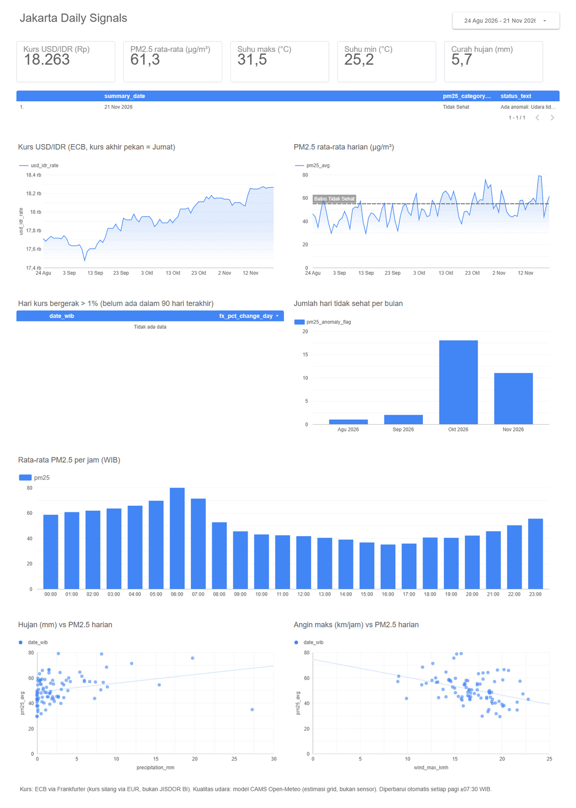
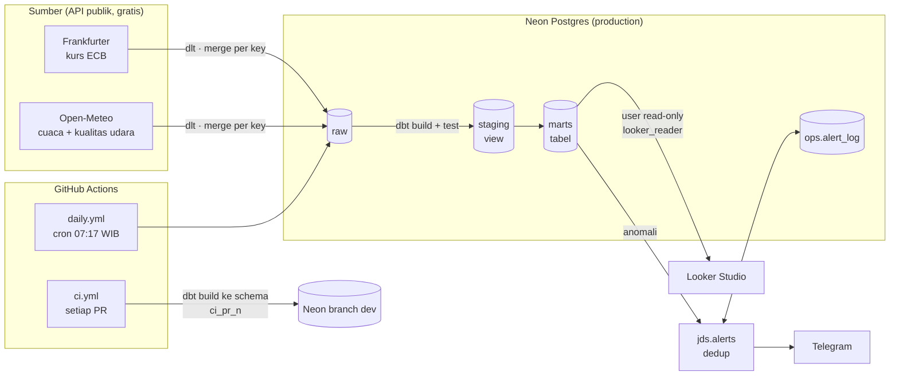

# Jakarta Daily Signals

[](https://github.com/Tedyhermawanto21/jakarta-daily-signals/actions/workflows/daily.yml)
[](https://github.com/Tedyhermawanto21/jakarta-daily-signals/actions/workflows/ci.yml)

Pipeline data harian **end-to-end tanpa server dan tanpa biaya** yang merangkum kurs USD/IDR, cuaca, dan
kualitas udara Jakarta. Setiap pagi data diambil, dimuat secara idempoten, ditransformasi dan diuji,
lalu ringkasannya dikirim ke Telegram. Ringkasan diberi tanda ⚠️ kalau ada anomali: kurs bergerak lebih
dari 1% atau rata-rata PM2.5 harian di atas 55 µg/m³.

**📊 Dashboard publik:** [Looker Studio · Jakarta Daily Signals](https://datastudio.google.com/reporting/218f441e-1252-4c35-bd68-23b86e2d57ea)



---

## Apa yang dijawab

| Pertanyaan | Temuan (data 23 Agu – 21 Nov 2026) |
|---|---|
| Bagaimana tren kurs USD/IDR, dan kapan perubahannya lebih dari 1%? | Rupiah melemah dari ±17.700 ke ±18.260. Belum ada satu hari pun dengan perubahan lebih dari 1% (terbesar +0,78%). |
| Berapa hari per bulan PM2.5 di atas 55 µg/m³? | Agustus 1, September 2, **Oktober 18**, November 11 (sampai tanggal 21). |
| Jam berapa PM2.5 paling buruk? | **06:00 WIB** (rata-rata ±80 µg/m³). Paling rendah sekitar 16:00. |
| Apakah hari hujan atau berangin lebih bersih? | Angin: ya (korelasi −0,37). Hujan: **tidak terbukti** (+0,28), kemungkinan karena hujan lebih sering turun sore hari, sedangkan polusi memuncak pagi hari. |
| Bagaimana ringkasan kemarin? | Kartu skor dan tabel status, isinya sama dengan pesan Telegram pagi ini. |

## Arsitektur



**Alur harian (sekitar 2 menit):** cek schema → ingest 7 hari terakhir (dlt, `merge`) → `dbt build` (model + test) →
`dbt source freshness` → ringkasan Telegram (paling banyak 1× per hari, di-dedup lewat `ops.alert_log`).

| Lapisan | Isi |
|---|---|
| `raw` | Tabel hasil dlt: `fx_rates`, `weather_daily`, `air_quality_hourly`. Primary key per tanggal/jam, jadi rerun menimpa baris, tidak menambah. |
| `staging` | View `stg_*` (nama kolom dan tipe dirapikan) dan `int_*` (perubahan kurs harian, ringkasan PM2.5 harian dari jam aktual). |
| `marts` | `fct_daily_signals`, `fct_anomalies` (aturan anomali), dan `dash_*`: tabel kecil per grain untuk dashboard. |
| `ops` | `alert_log`: catatan pesan Telegram yang sudah terkirim. |

## Stack

| Bagian | Pilihan | Versi (dari `uv.lock`) |
|---|---|---|
| Ingest | [dlt](https://dlthub.com) | 1.32.0 |
| Gudang data | [Neon](https://neon.tech) Postgres (free tier) | — |
| Transformasi + test | dbt Core + dbt-postgres | 1.12.7 / 1.11.0 |
| Orkestrasi + CI | GitHub Actions | `actions/checkout@v7.0.1`, `astral-sh/setup-uv@v10.3.3` |
| Dashboard | Looker Studio (konektor PostgreSQL) | — |
| Alert | Telegram Bot API (`requests` + `tenacity`) | 2.34.2 / 9.2.1 |
| Lingkungan | Python 3.11, [uv](https://docs.astral.sh/uv/) 0.13.5, DuckDB untuk uji lokal | duckdb 1.5.6 |
| Kualitas kode | pytest, ruff, sqlfluff | 8.4.2 / 0.17.6 / 3.5.0 |

Biaya bulanan: **Rp0**. Repo publik membuat menit GitHub Actions tidak terbatas, dan Neon, Looker Studio,
Telegram, serta kedua API dipakai di paket gratis.

## Keandalan

- **Idempoten:** semua load memakai `write_disposition="merge"` dengan primary key. Menjalankan ulang tanggal
  yang sama tidak menambah baris. Ini dibuktikan oleh test (`tests/test_idempotency.py`) dan uji mutasi: kalau
  `merge` diganti `append`, test langsung gagal.
- **Retry yang aman:** GET diulang untuk timeout, 429, dan 5xx, tapi tidak untuk 4xx lain. POST Telegram
  **tidak** diulang saat *read timeout*, karena pesannya mungkin sudah terkirim. Token disamarkan di semua log.
- **Alert maksimal 1× per hari:** baris `ops.alert_log` dipesan dulu (`sending`), pesan dikirim, lalu statusnya
  ditandai `sent` (pola *at-most-once*).
- **Test data:** test `not_null`, `unique`, rentang nilai, tidak ada tanggal bolong, 24 jam per hari, unit test
  aturan anomali, dan source freshness. Totalnya 63 node dbt dan 72 test pytest.
- **CI di setiap PR:** ruff, sqlfluff, pytest, dan `dbt parse` (tanpa rahasia), lalu `dbt build` ke schema
  sementara `ci_pr_<n>` di **branch dev** Neon, yang dihapus setelah run. Bukti: [PR #1](https://github.com/Tedyhermawanto21/jakarta-daily-signals/pull/1)
  memuat commit yang sengaja merusak aturan anomali (🔴), lalu commit yang memperbaikinya (🟢).
- **Dashboard read-only:** Looker Studio memakai user `looker_reader` yang hanya bisa `SELECT` di `marts`
  ([sql/grants_looker_reader.sql](sql/grants_looker_reader.sql)). `python -m jds.check_reader` membuktikan
  dua lapisan pengamannya: transaksi read-only (`25006`) dan GRANT (`42501`), bahkan saat transaksi dipaksa
  `READ WRITE`.
- **Pengaman lingkungan:** workflow production menolak berjalan kalau `DATABASE_URL` tidak mengarah ke host
  `EXPECTED_DB_HOST`.

## Menjalankan dari nol

### 1. Lokal, tanpa akun apa pun (DuckDB)

Butuh [uv](https://docs.astral.sh/uv/getting-started/installation/). uv akan memasang Python 3.11 sendiri.

```bash
git clone https://github.com/Tedyhermawanto21/jakarta-daily-signals.git
cd jakarta-daily-signals
uv sync                                                  # dependensi persis dari uv.lock
uv run pytest                                            # semua test (HTTP di-mock, tanpa internet)
uv run python -m jds.pipeline --source all --dest duckdb # 7 hari terakhir -> data/jds_local.duckdb
uv run python -m jds.pipeline --dest duckdb              # jalankan lagi: jumlah baris tetap sama
uv run python -m jds.peek air_quality_hourly --limit 5   # intip isi tabel
uv run python -m jds.ui                                  # DuckDB UI di http://localhost:4213
```

### 2. Dengan Neon Postgres + dbt

1. Buat project gratis di [neon.tech](https://neon.tech) dengan database `jds`. Salin connection string
   **tanpa** `-pooler`.
2. `cp .env.example .env`, lalu isi `DATABASE_URL`. `.env` tidak pernah di-commit.
3. Jalankan:

```bash
uv run python -m jds.check_db --init                     # cek koneksi + buat schema raw/staging/marts/ops
uv run python -m jds.pipeline --dest postgres --start 2026-08-23   # backfill (opsional)
uv run python -m jds.run_dbt build                       # model + semua test
uv run python -m jds.run_dbt source freshness
uv run python -m jds.alerts.run_alerts --dry-run         # tampilkan pesan Telegram tanpa mengirim
```

`jds.run_dbt` memecah `DATABASE_URL` menjadi variabel `DBT_PG_*` untuk `transform/profiles.yml`, sehingga
kredensial hanya punya satu sumber.

### 3. Telegram (opsional)

Buat bot lewat [@BotFather](https://t.me/BotFather), isi `TELEGRAM_BOT_TOKEN`, kirim `/start` ke bot, lalu ambil
chat id dengan `uv run python -m jds.alerts.telegram --chat-id` dan isi `TELEGRAM_CHAT_ID`.

### 4. Menjalankan otomatis di GitHub Actions

| Nama | Jenis | Isi |
|---|---|---|
| `DATABASE_URL` | Secret | URL Neon branch **production** |
| `CI_DATABASE_URL` | Secret | URL Neon branch **dev** (untuk CI) |
| `TELEGRAM_BOT_TOKEN`, `TELEGRAM_CHAT_ID` | Secret | Kredensial bot |
| `EXPECTED_DB_HOST` | **Variable** | Endpoint ID production, mis. `ep-xxxx-123456` |

Workflow `daily` berjalan setiap hari pukul 07:17 WIB, dan bisa juga dijalankan manual
(**Actions → daily → Run workflow**) dengan tanggal `start`/`end` untuk backfill.

## Keputusan desain dan pelajaran

- **BigQuery → Neon Postgres.** Rencana awal memakai BigQuery, tapi billing account Google Cloud tidak bisa
  diaktifkan. Neon gratis tanpa kartu, memakai Postgres standar (didukung dlt, dbt, dan Looker Studio), dan punya
  *branching*, sehingga dev dan CI tidak pernah menyentuh production. Untuk ±30 baris per hari, kelebihan gudang
  data kolumnar belum relevan.
- **Satu ringkasan per hari, bukan satu alert per anomali.** Saat pratinjau, PM2.5 melewati 55 pada 5 dari 7
  hari. Kalau setiap anomali punya pesan sendiri, penerima akan cepat mengabaikannya (*alert fatigue*). Jadi
  dikirim satu ringkasan pagi dengan banner ⚠️.
- **Anomali PM2.5 hanya dinilai untuk hari lengkap** (24 jam aktual, tanpa jam prakiraan). Kurs yang dilaporkan
  adalah kurs as-of **kemarin**, karena ECB baru terbit sekitar 22:00 WIB.
- **Open-Meteo hanya menyimpan sekitar 75 hari di endpoint prakiraan.** Backfill 90 hari menghasilkan nilai
  `null` dengan status HTTP 200 (tanpa error). Masalah ini ditemukan lewat log "suhu kosong: N", lalu sumber
  diganti ke Historical Forecast API dan baris yang rusak diperbaiki ulang lewat `merge`.
- **Test tidak boleh bergantung pada jam dinding.** Test "24 jam per hari" awalnya memakai `now()`, sehingga
  gagal di CI setiap kali datanya sudah berumur sehari. Sekarang patokannya hari aktual terakhir di data, dan
  pengecekan data basi diserahkan ke `source freshness`.
- **Satu mart per grain untuk dashboard** (`dash_daily_signals`, `dash_air_quality_hourly`,
  `dash_latest_summary`). Data harian dan per jam tidak digabung, karena "jumlah hari > 55" akan terhitung
  24×. Kurs akhir pekan diteruskan dari Jumat, tapi perubahan % dan penanda anomalinya hanya muncul di hari
  terbit, supaya anomali hari Jumat tidak terhitung tiga kali.
- **User Looker dibuat lewat SQL, bukan lewat menu Roles di Neon Console.** Role dari Console otomatis menjadi
  anggota `neon_superuser`. `ALTER DEFAULT PRIVILEGES` diperlukan karena dbt membuat ulang tabel setiap run,
  sehingga grant pada tabel lama ikut hilang.
- **Workflow hijau belum tentu benar.** Secret `DATABASE_URL` pernah tidak sengaja berisi URL dev. Workflow
  tetap sukses, tapi datanya masuk ke database yang salah. Masalah ini ketahuan karena pemeriksaan read-only
  dijalankan ke production sungguhan. Pengamannya sekarang `EXPECTED_DB_HOST`.
- **Tanpa dltHub dashboard.** Paket `dlt[hub]` berlisensi komersial yang membatasi penggunaan pada layanan
  dltHub. Untuk melihat data lokal, proyek ini memakai DuckDB UI.
- **Telemetri dimatikan** untuk dlt (`RUNTIME__DLTHUB_TELEMETRY=false`) dan dbt (`send_anonymous_usage_stats: false`).

## Catatan portabilitas ke BigQuery

Semua load lewat dlt dan semua transformasi lewat dbt, jadi pindah ke BigQuery terutama berarti mengganti
destination dlt (`postgres` → `bigquery`) dan adapter dbt (`dbt-postgres` → `dbt-bigquery`). SQL yang perlu
disesuaikan:

| Postgres (sekarang) | BigQuery |
|---|---|
| `left join lateral (... limit 1)` untuk kurs as-of | `QUALIFY row_number() over (...) = 1` atau `LAST_VALUE(... IGNORE NULLS)` |
| `(array_agg(x order by ...))[1]` | `ARRAY_AGG(x ORDER BY ... LIMIT 1)[OFFSET(0)]` |
| `to_char` + `translate` untuk format angka Indonesia | `FORMAT("%'.1f", ...)` + `REPLACE` |
| `now() at time zone 'Asia/Jakarta'` | `CURRENT_DATETIME('Asia/Jakarta')` |
| `to_timestamp(_dlt_load_id::numeric)` | `TIMESTAMP_SECONDS(CAST(CAST(_dlt_load_id AS NUMERIC) AS INT64))` |
| Schema `ci_pr_<n>` + `jds.ci_schemas` | Dataset `ci_pr_<n>` + `bq rm -r` |
| Role `looker_reader` + GRANT | Service account dengan IAM *BigQuery Data Viewer* di dataset `marts` |

## Batasan

- Kurs berasal dari ECB (kurs silang via EUR, hanya hari kerja Eropa), **bukan** JISDOR Bank Indonesia.
- Kualitas udara berasal dari **model** CAMS (estimasi grid kasar), bukan sensor stasiun. Lokasinya baru satu titik
  (Monas). Menambah lokasi cukup dengan satu baris di `src/jds/config.py`.
- Cron GitHub Actions bisa terlambat 10–30 menit, dan dinonaktifkan otomatis setelah 60 hari tanpa aktivitas di repo.

## Struktur repo

```
.github/workflows/   daily.yml (cron + backfill manual), ci.yml (setiap PR)
src/jds/             pipeline.py, sources/ (dlt), run_dbt.py, alerts/ (rules, telegram, run_alerts),
                     check_db.py, check_reader.py, ci_schemas.py, peek.py, ui.py
transform/           proyek dbt: models/{staging,intermediate,marts}, tests/, macros/
sql/                 grants_looker_reader.sql
tests/               pytest (HTTP di-mock, idempotensi dengan DuckDB sementara)
docs/PLAN.md         rencana, keputusan, dan urutan tahap pengerjaan
```
