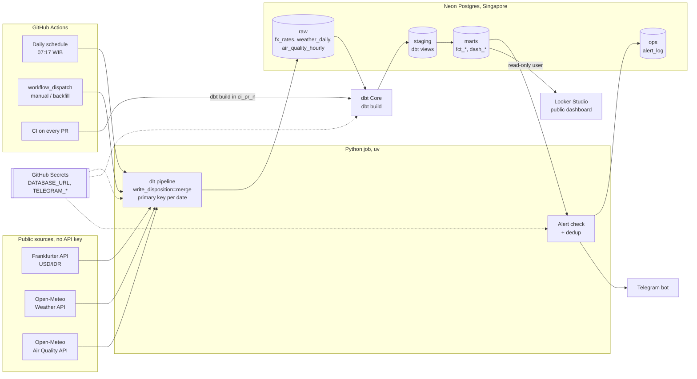

# Jakarta Daily Signals: Project Plan

> Status: **stages 0–12 done** (2026-11-22). Remaining Definition of Done item: seven consecutive
> scheduled runs (counting from 2026-11-22). Written 2026-11-21.
> **Revision 2026-11-21:** the warehouse moved from BigQuery to **Neon (serverless Postgres, free,
> no card)** because the Google Cloud billing account could not be activated. The dashboard stays
> on **Looker Studio** (free) through its PostgreSQL connector.

---

## 1. Project brief

### Problem
Daily information that matters to people living and working in Jakarta is scattered: the USD/IDR
rate on one site, the weather on another, air quality in yet another app. None of them say when
something is **unusual**, such as a sharp rupiah move or unhealthy air, so people either check
every day or find out too late.

### Users
| Persona | Need |
|---|---|
| Jakarta commuter | Whether today calls for a mask or an umbrella |
| Importer, small business owner or freelancer paid in USD | Whether the exchange rate moved sharply |
| (Portfolio) recruiter or hiring manager | A reliable, tested, low-cost end-to-end pipeline |

### Questions the dashboard answers
1. What is the USD/IDR trend over the last 30/90 days, and on which days did it move more than 1%?
2. What is the average daily PM2.5, and how many days per month are above 55 µg/m³?
3. At what hour of the day is PM2.5 usually worst (WIB)?
4. Do rainy or windy days tend to have lower PM2.5?
5. What does today and yesterday look like: rate, min/max temperature, rain, PM2.5, alert status?

### Definition of Done
- [ ] The scheduled GitHub Actions workflow runs on its own every day for **at least 7 consecutive days**.
- [x] Raw data and marts live in **Neon Postgres**. **Re-running the same dates adds no rows** (proven by row counts).
- [x] `dbt build` passes, with `unique`, `not_null`, `accepted_range` and freshness checks.
- [x] Every PR runs CI (lint plus `dbt build` in a separate CI schema). A PR that breaks a test turns red.
- [x] Telegram reports threshold breaches **at most once per anomaly and date**, even when the pipeline is re-run.
- [x] A public Looker Studio dashboard answers the five questions using a **read-only** database user.
- [x] The README has an architecture diagram, local setup, a dashboard screenshot and the design decisions (including why the project left BigQuery).
- [x] No credentials in the repo. Checked by GitGuardian on every PR and by a local scan against the real `.env` values. (The generic pattern `git log -p | grep -iE "postgres(ql)?://[^ ]+:[^ ]+@"` gives false positives on format examples and fake test values such as `<password>` and `p%40ss`.)

---

## 2. Architecture



One daily run: **ingest (dlt) → transform and test (dbt build) → check anomalies → send to
Telegram if not sent yet → record in alert_log**. If a step fails, later steps do not run, so no
alert is ever sent from data that failed its tests.

### Why a scheduled serverless batch fits
- **The data is daily.** The ECB publishes once per business day, and weather and air quality are
  summarized per day. Streaming or an always-on server would only add cost.
- **No servers to maintain.** GitHub Actions runners are created per run and thrown away. Neon is
  serverless too: the compute sleeps when idle and wakes on connection.
- **Zero cost, no card.** Around 30 rows per day, far below every free tier.
- **Easy to re-run.** Per-date batches plus merge make reruns and backfills safe.
- **Code and orchestration in one repo.** Recruiters can see everything, including run history.

Trade-off: data is at most 24 hours old, and GitHub schedules can be delayed. Fine for a daily summary.

---

## 3. Stack review

| Component | Why | Alternative | Overkill? |
|---|---|---|---|
| **dlt** (ingestion) | Merge on primary keys, schema evolution and a Postgres loader out of the box; testable locally against DuckDB without any account. | `requests` + `psycopg` by hand | Slightly, for three simple APIs, but it saves a lot of idempotency code. **Kept.** |
| **Neon Postgres** (storage) | Free without a card, serverless, standard Postgres (supported by dlt, dbt and Looker Studio), with **branching** for dev and CI. | BigQuery (needs billing), Supabase, MotherDuck (no Looker Studio connector) | No. Not columnar, but irrelevant at ~30 rows per day. |
| **dbt Core** (transformation) | Lineage, data tests, docs and modular SQL. Industry standard. | Plain Postgres views | A bit heavy for ~6 models, but that is what the project demonstrates. **Kept**, without extra packages. |
| **GitHub Actions** (orchestration + CI) | Free, cron and CI in one place, public run history. | Cron on a VPS | No. Airflow would be the overkill here. |
| **Looker Studio** (dashboard) | Free, drag and drop, built-in PostgreSQL connector, easy public sharing. | Streamlit Community Cloud, Evidence | No. |
| **Telegram bot** (alerts) | Free, simple HTTP API, lands on the phone. | SMTP email, Discord webhook | No. |

**Portability:** all SQL lives in dbt and all loading goes through dlt. Moving to BigQuery means
switching the dlt destination and the dbt adapter, plus some dialect changes (listed in the README).

### Package versions
Exact versions are resolved by `uv lock` and recorded in `uv.lock` and the README, not guessed.
Constraints: Python 3.11, `dlt[duckdb,postgres] >=1.32,<2`, `dbt-core <1.13` with `dbt-postgres <1.12`,
`requests >=2.32,<3`, `tenacity >=9,<10`, `python-dotenv >=1,<2`; dev: `pytest`, `ruff`, `sqlfluff`.

---

## 4. Free-tier limits and workarounds

| Service | Limit that can bite | Workaround |
|---|---|---|
| **Neon (Free)** | Monthly storage and compute-hour quotas. The compute **suspends** after a few idle minutes, so the first connection waits (cold start). **SSL required.** | Tiny volume. Connection retries in Python and dbt. Always `sslmode=require`. |
| **Neon + Looker Studio** | Viewers query through the data source owner's credentials. Some clients without SNI support cannot reach Neon. | A dedicated **`looker_reader`** with `SELECT` on `marts` only. If SNI fails, put the endpoint ID in the password (`endpoint=<endpoint_id>;<password>`). Looker also requires the server CA (ISRG Root X1) when SSL is on. |
| **Looker Studio** | Cached data, no alerting. | Short data freshness, alerting via Telegram, small pre-aggregated marts. |
| **GitHub Actions** | Cron runs in **UTC** and can be **late or skipped** under load (especially at :00). Scheduled workflows are **disabled after 60 days without repo activity**. | Odd minute: `17 0 * * *` = 07:17 WIB. `workflow_dispatch` for manual runs. Idempotent jobs. Public repo (unlimited minutes). Commit occasionally. |
| GitHub Actions (CI) | PRs from forks **get no secrets**. | Lint, pytest and `dbt parse` always run; `dbt build` against Neon only for same-repo PRs. |
| **Frankfurter** | ECB data: **European business days only**, published around 16:00 CET (≈ 22:00 WIB). IDR is a **cross rate via EUR**, not Bank Indonesia's JISDOR. | % change vs the **previous published rate**, not "yesterday". Say so on the dashboard. |
| **Open-Meteo** | Free for non-commercial use, ~10,000 calls/day. Air quality is the **CAMS model**, not station sensors. The forecast endpoint `api.open-meteo.com/v1/forecast` keeps only **~75 days**: older dates still return HTTP 200 with `null` values (found during the stage 6 backfill). | 3–5 calls per day. Retries for 429/5xx. Weather uses the **Historical Forecast API**, which returns identical values for overlapping dates and also covers today and the forecast. Missing days are logged. |
| **Telegram bot** | A bot **cannot start a chat**: send `/start` first to get a `chat_id`. ~1 message/second per chat. | Documented setup. One short message per run. |

---

## 5. Repository layout

```
.github/workflows/   daily.yml (schedule + manual backfill), ci.yml (every PR)
src/jds/             config, logging_setup, http, check_db, pipeline, sources/ (dlt resources),
                     run_dbt, ci_schemas, check_reader, peek, ui, alerts/ (rules, telegram, run_alerts)
transform/           dbt project: models/{staging,intermediate,marts}, tests/, macros/, profiles.yml
sql/                 grants_looker_reader.sql
tests/               pytest (HTTP mocked, idempotency against a temporary DuckDB)
docs/                PLAN.md, img/dashboard.png
```

---

## 6. Data design and idempotency

| Table | Grain | Merge key |
|---|---|---|
| `raw.fx_rates` | one row per rate date and pair | `(rate_date, base, quote)` |
| `raw.weather_daily` | one row per WIB date and location | `(date_wib, location_id)` |
| `raw.air_quality_hourly` | one row per WIB hour and location | `(ts_wib, location_id)` |
| `ops.alert_log` | one row per sent summary or anomaly | `(signal_date, alert_type, location_id)` |

- Open-Meteo requests use `timezone=Asia/Jakarta`; dates are stored as `date_wib`, hours as `timestamptz`.
- Re-running a date overwrites rows with the same key instead of adding new ones.
- Anomaly rules:
  - **FX:** `abs(rate_t / rate_previous_business_day - 1) > 1%`
  - **PM2.5:** daily mean over 24 WIB hours `> 55 µg/m³` (the ISPU "unhealthy" boundary), with the
    peak hour in the message, judged on **complete days only** (24 actual hours, no forecasts).
- **Delivery (decided 2026-11-21):** no separate alert messages. One **summary per morning**, with
  a ⚠️ line on top when there are new anomalies. The stage 3 preview showed PM2.5 above 55 on 5 of
  7 days, so separate alerts would cause alert fatigue. Dedup still goes through `ops.alert_log`.

### Credentials
| Name | Used by | Stored in |
|---|---|---|
| `DATABASE_URL` | dlt, dbt, alerts (owner role) | local `.env` + GitHub Secrets |
| `CI_DATABASE_URL` | CI (Neon dev branch) | GitHub Secrets |
| `TELEGRAM_BOT_TOKEN`, `TELEGRAM_CHAT_ID` | alerts | local `.env` + GitHub Secrets |
| `looker_reader` password | Looker Studio | Looker Studio (and optionally local `.env` for `check_reader`) |
| `EXPECTED_DB_HOST` | daily workflow guard | GitHub repository variable (not a secret) |

Every module reads `DATABASE_URL` through `jds.config`; dlt receives it as `credentials`, and dbt
gets it through `jds.run_dbt`, which splits it into `DBT_PG_*` for `profiles.yml`.

---

## 7. Stages (each with a visible test)

| # | Stage | Output | How to verify |
|---|---|---|---|
| 0 | **Local setup** | `pyproject.toml`, `.gitignore`, `.env.example`, git repo | `uv sync` succeeds; `dlt --version` and `dbt --version` print; `git status` does not show `.env`. |
| 1 | **Neon setup** | Project in Singapore, database `jds`, schemas `raw/staging/marts/ops`, `dev` branch | `uv run python -m jds.check_db` prints the Postgres version and the four schemas. |
| 2 | **FX → local DuckDB** | Frankfurter dlt resource | `jds.pipeline --source fx --dest duckdb`, then USD/IDR rows in DuckDB. |
| 3 | **Weather + air → DuckDB** | Open-Meteo resources | One weather row and 24 air rows for a test date. |
| 4 | **Idempotency + unit tests** | pytest with mocked HTTP | `uv run pytest` green; two runs for the same dates keep row counts. |
| 5 | **Switch to Neon (`dev` branch)** | `postgres` destination | Tables visible in Neon; no duplicates after two runs. |
| 6 | **~90-day backfill** | `--start/--end` | About 90 days of FX and PM2.5 in Neon. |
| 7 | **dbt models + tests** | staging → intermediate → marts via `jds.run_dbt` | `jds.run_dbt build` passes; a forced NULL makes a test fail. |
| 8 | **Telegram alerts** | rules + dedup | `--dry-run` prints the message; a real run delivers it; a rerun logs "already sent". |
| 9 | **Daily workflow** | `daily.yml` + secrets, writing to the production branch | Manual run is green; the next morning the schedule runs on its own. |
| 10 | **CI on PRs** | `ci.yml`, `ci_pr_<n>` schemas dropped after each run | A PR with a deliberately broken test turns red, the fix turns it green. |
| 11 | **Looker Studio dashboard** | `looker_reader`, PostgreSQL data sources with SSL, five charts | The public link opens without login; `looker_reader` cannot `INSERT`. |
| 12 | **README and polish** | Diagram, screenshot, design decisions, BigQuery notes | Someone can follow the README from a fresh clone. |

---

## 8. Decisions

| # | Question | Decision |
|---|---|---|
| 1 | Warehouse | **Neon Postgres (Free).** BigQuery was dropped because the Google Cloud billing account was closed and could not be reopened. |
| 2 | PM2.5 threshold | Daily mean > 55 µg/m³ on complete days, peak hour in the message, **merged into the daily summary** with a ⚠️ marker instead of separate messages (5 of 7 preview days were above the threshold). *(2026-11-21)* |
| 3 | FX source | Frankfurter/ECB, with an honest note on the dashboard. |
| 4 | Location | One point: Monas (-6.1754, 106.8272); `location_id` keeps it easy to add more. |
| 5 | Repository | Public. |
| 6 | Send time | 07:17 WIB (`17 0 * * *` UTC): last business-day FX rate, yesterday's weather and PM2.5, today's forecast. |
