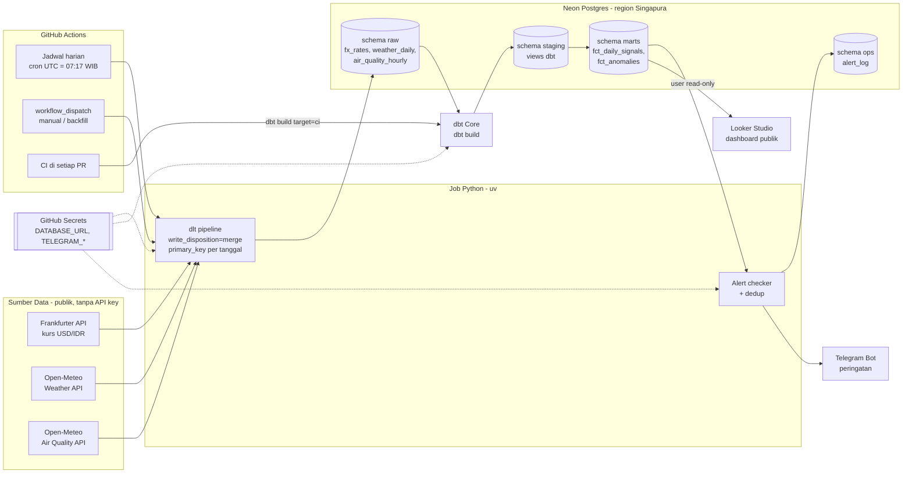

# Jakarta Daily Signals — Rencana Proyek

> Status: perencanaan (belum ada kode). Disusun 2026-11-21.
> **Revisi 2026-11-21:** gudang data diganti dari BigQuery ke **Neon (Postgres serverless, gratis tanpa kartu)** karena billing account Google Cloud tidak bisa diaktifkan. Dashboard tetap **Looker Studio** (gratis), tersambung lewat konektor PostgreSQL.

---

## 1. Project Brief

### Masalah
Informasi harian yang relevan untuk warga dan pekerja di Jakarta tersebar di banyak tempat. Kurs USD/IDR ada di satu situs, cuaca di situs lain, dan kualitas udara di aplikasi lain lagi. Semua sumber itu juga tidak memberi tahu kalau ada hal yang **tidak biasa**, misalnya rupiah melemah tajam atau udara masuk kategori tidak sehat. Akibatnya orang harus mengecek sendiri setiap hari, atau baru tahu setelah terlambat.

### Pengguna
| Persona | Kebutuhan |
|---|---|
| Pekerja komuter Jakarta | Tahu apakah hari ini perlu masker atau payung |
| Pelaku UMKM impor / freelancer berpenghasilan USD | Tahu kalau kurs bergerak tajam |
| (Portofolio) Rekruter / hiring manager | Melihat pipeline end-to-end yang andal, teruji, dan murah |

### Pertanyaan yang dijawab dashboard
1. Bagaimana tren kurs USD/IDR 30/90 hari terakhir, dan di hari apa saja perubahannya melebihi 1%?
2. Berapa rata-rata PM2.5 harian, dan berapa hari per bulan nilainya di atas 55 µg/m³?
3. Pada jam berapa PM2.5 biasanya paling buruk? (pola per jam, WIB)
4. Apakah hari hujan atau berangin cenderung punya PM2.5 lebih rendah? (curah hujan & kecepatan angin vs PM2.5)
5. Bagaimana ringkasan "hari ini/kemarin": kurs, suhu min/max, hujan, PM2.5, dan status peringatan?

### Definisi selesai (Definition of Done)
- [ ] Workflow GitHub Actions terjadwal berjalan otomatis setiap hari selama **≥ 7 hari berturut-turut** tanpa intervensi.
- [ ] Data mentah dan mart ada di **Neon Postgres**. **Menjalankan ulang untuk tanggal yang sama tidak menambah baris** (terbukti lewat query hitung baris).
- [ ] `dbt build` lulus, dengan test `unique`, `not_null`, `accepted_range`, dan freshness.
- [ ] Setiap PR menjalankan CI (lint + `dbt build` di schema CI terpisah). PR yang merusak test berstatus merah.
- [ ] Telegram mengirim peringatan saat ambang terlampaui, **maksimal 1 kali per anomali per tanggal** walau pipeline dijalankan ulang.
- [ ] Dashboard Looker Studio publik menjawab 5 pertanyaan di atas, memakai user database **read-only**.
- [ ] README berisi diagram arsitektur, cara menjalankan lokal, screenshot dashboard, dan keputusan desain (termasuk alasan pindah dari BigQuery).
- [ ] Tidak ada kredensial di repo (dicek dengan `git log -p | grep -iE "postgres(ql)?://[^ ]+:[^ ]+@"` → kosong).

---

## 2. Arsitektur



Urutan satu kali jalan harian: **ingest (dlt) → transform + test (dbt build) → cek anomali → kirim Telegram (jika belum pernah dikirim) → catat di alert_log**. Kalau satu langkah gagal, langkah berikutnya tidak jalan. Dengan begitu tidak ada peringatan yang dikirim dari data yang belum lolos test.

### Kenapa pola cloud / serverless batch terjadwal cocok
- **Datanya memang harian.** Kurs ECB terbit sekali per hari kerja, dan ringkasan cuaca/udara bersifat harian. Streaming atau server yang menyala 24/7 hanya membuang biaya.
- **Tidak ada server yang perlu dirawat.** Runner GitHub Actions dibuat untuk satu kali jalan lalu dibuang. Neon juga serverless: compute tidur saat tidak dipakai dan bangun otomatis saat ada koneksi.
- **Biaya Rp0, tanpa kartu.** Volumenya sekitar 30 baris/hari, jauh di bawah kuota gratis semua layanan.
- **Mudah dijalankan ulang.** Batch per tanggal + merge membuat rerun dan backfill aman. Ini sulit dicapai di pola streaming.
- **Kode dan orkestrasi di satu repo.** Bagus untuk portofolio karena rekruter bisa melihat semuanya, termasuk riwayat run.

Batasan pola ini: latensi baru terasa setelah jadwal berikutnya (≤ 24 jam), dan jadwal GitHub bisa terlambat. Untuk ringkasan harian, itu bisa diterima.

---

## 3. Evaluasi Stack

| Komponen | Kenapa dipilih | Alternatif | Berlebihan? |
|---|---|---|---|
| **dlt** (ingestion) | Merge/primary key, evolusi skema, state incremental, dan loader Postgres sudah tersedia. Bisa uji lokal ke DuckDB tanpa akun apa pun. | `requests` + `psycopg` manual | Sedikit, untuk 3 API sederhana. Tapi dlt menghemat banyak kode idempotensi, dan "pernah pakai dlt" punya nilai jual. **Tetap.** |
| **Neon Postgres** (storage) | Gratis tanpa kartu, serverless, Postgres standar (dlt, dbt, dan Looker Studio semuanya mendukung). Punya fitur **branching** (salinan database untuk dev/CI). | BigQuery (butuh billing aktif), Supabase (Postgres juga), MotherDuck (tanpa konektor Looker Studio) | Tidak. Postgres bukan gudang data kolumnar, tapi untuk ±30 baris/hari itu tidak relevan. |
| **dbt Core** (transformasi) | Lineage, test data, dokumentasi, dan modularitas SQL. Standar industri. | SQL view biasa di Postgres | Untuk ±6 model memang agak berat, tapi justru itu yang mau dipamerkan. **Tetap.** Jangan tambah paket dbt yang tidak perlu. |
| **GitHub Actions** (orkestrasi + CI) | Gratis, cron + CI dalam satu tempat, riwayat run publik. | Cron di VPS | Tidak. Airflow **yang** berlebihan di sini. |
| **Looker Studio** (dashboard) | Gratis, drag & drop, konektor PostgreSQL bawaan, mudah dibagikan publik. | Streamlit Community Cloud / Evidence | Tidak. |
| **Telegram Bot** (alert) | Gratis, API HTTP sederhana, langsung masuk ke HP. | Email via SMTP / Discord webhook | Tidak. |

**Catatan portabilitas (untuk README):** semua SQL ditulis di dbt dan semua load lewat dlt. Pindah ke BigQuery nanti cukup dengan mengganti destination dlt (`postgres` → `bigquery`) dan adapter dbt (`dbt-postgres` → `dbt-bigquery`), plus sedikit penyesuaian dialek SQL.

### Versi paket (kandidat, dikunci di Tahap 0)
| Paket | Versi target | Catatan kecocokan |
|---|---|---|
| Python | 3.11.x | Didukung dlt 1.x & dbt 1.x |
| `dlt[postgres,duckdb]` | `>=1.x,<2` (minor terbaru yang lolos `uv lock`) | `duckdb` untuk uji lokal Tahap 2–4 |
| `dbt-core` | minor terbaru yang stabil | |
| `dbt-postgres` | samakan minor dengan dbt-core | |
| `requests` | `>=2.32,<3` | |
| `tenacity` | `>=9,<10` | retry + backoff |
| `python-dotenv` | `>=1,<2` | baca `.env` lokal |
| `pytest` (dev) | `>=8,<9` | |
| `ruff`, `sqlfluff` (dev) | terbaru stabil | lint Python & SQL di CI |

Versi persisnya **tidak ditebak**. Di Tahap 0 kita jalankan `uv lock` + `uv sync`, lalu versi hasil resolve dicatat di `uv.lock` dan README. Kalau ada konflik dependensi antara dlt dan dbt, akan langsung terlihat di langkah itu.

---

## 4. Batasan Free Tier & Cara Menyiasatinya

| Layanan | Batasan yang bisa mengganggu | Siasat |
|---|---|---|
| **Neon (Free)** | Kuota storage & jam compute per bulan terbatas (cek angka terbaru di halaman pricing Neon). Compute **tidur otomatis** setelah beberapa menit idle; koneksi pertama butuh waktu bangun (cold start). Koneksi **wajib SSL**. | Volume proyek ini sangat kecil. Retry koneksi di Python & dbt untuk cold start. Selalu pakai `sslmode=require`. |
| **Neon + Looker Studio** | Looker Studio mengakses database dengan kredensial pemilik, jadi viewer dashboard secara tidak langsung memakai user itu. Beberapa klien tanpa dukungan SNI gagal terhubung ke Neon. | Buat user khusus **`looker_reader`** yang hanya bisa `SELECT` di schema `marts`. Kalau koneksi Looker Studio gagal karena SNI/endpoint, pakai cara di docs Neon (menyertakan endpoint ID di password: `endpoint=<endpoint_id>;<password>`). |
| **Looker Studio** | Data di-cache (default beberapa jam), dan tidak ada alerting | Atur data freshness serendah mungkin. Alerting ditangani Telegram. Buat mart kecil yang sudah diagregasi supaya query dashboard ringan. |
| **GitHub Actions** | Cron dalam **UTC**. Jadwal bisa **terlambat / di-skip** saat beban tinggi (terutama di menit :00). Workflow terjadwal **dinonaktifkan otomatis setelah 60 hari tanpa aktivitas repo** (repo publik). | Pakai menit "aneh": `17 0 * * *` = 07:17 WIB. Tambahkan `workflow_dispatch` untuk run manual. Job idempoten, jadi run susulan aman. Repo publik (menit tak terbatas). Commit sesekali. |
| GitHub Actions (CI) | PR dari fork **tidak menerima secrets** | Lint + `dbt parse` (tanpa kredensial) selalu jalan; `dbt build` ke Neon hanya untuk PR dari repo sendiri |
| **Frankfurter** | Data dari ECB: **hanya hari kerja Eropa** (tidak ada akhir pekan/libur ECB), terbit ±16:00 CET (≈ 22:00 WIB). Kurs IDR adalah **kurs silang via EUR**, bukan JISDOR Bank Indonesia. | Perubahan % dihitung terhadap **hari kurs sebelumnya yang tersedia**, bukan "kemarin". Tulis sumber dengan jujur di dashboard. |
| **Open-Meteo** | Gratis untuk non-komersial, ±10.000 call/hari. Air quality adalah **model CAMS (estimasi grid)**, bukan sensor stasiun. ⚠️ Endpoint cuaca `api.open-meteo.com/v1/forecast` hanya menyimpan **±75 hari** ke belakang: tanggal lebih lama tetap HTTP 200 tapi nilainya `null` (ditemukan saat backfill Tahap 6). | Kita hanya butuh ±3–5 call/hari. Retry dengan backoff untuk 429/5xx. Cuaca memakai **Historical Forecast API** (`historical-forecast-api.open-meteo.com`): nilainya identik untuk tanggal yang tumpang tindih, dan juga mencakup hari ini + prakiraan. Log mencatat jumlah hari kosong. Cantumkan "data model" di dashboard. |
| **Telegram Bot** | Bot **tidak bisa memulai chat**: kamu harus `/start` bot dulu untuk mendapat `chat_id`. Batas ±1 pesan/detik per chat. | Langkah setup terdokumentasi. Satu pesan ringkas per run. |

---

## 5. Struktur Folder

```
serverless-cloud-data/                # repo: jakarta-daily-signals
├── .github/
│   └── workflows/
│       ├── daily.yml                 # cron harian + workflow_dispatch (param: tanggal backfill)
│       └── ci.yml                    # PR: ruff, pytest, sqlfluff, dbt build --target ci
├── src/
│   └── jds/                          # paket Python "jakarta daily signals"
│       ├── __init__.py
│       ├── config.py                 # baca env, konstanta (koordinat, TZ Asia/Jakarta, ambang)
│       ├── logging_setup.py          # konfigurasi logging terpusat
│       ├── http.py                   # session requests + retry (tenacity)
│       ├── sources/
│       │   ├── frankfurter.py        # dlt resource: fx_rates
│       │   └── open_meteo.py         # dlt resources: weather_daily, air_quality_hourly
│       ├── pipeline.py               # entrypoint: `uv run python -m jds.pipeline --date ...`
│       └── alerts/
│           ├── rules.py              # logika anomali (pure function, mudah diuji)
│           ├── telegram.py           # kirim pesan
│           └── run_alerts.py         # baca mart → dedup via ops.alert_log → kirim
├── transform/                        # proyek dbt
│   ├── dbt_project.yml
│   ├── profiles.yml                  # semua nilai via env_var(), tanpa rahasia
│   ├── packages.yml                  # (opsional) dbt_utils saja
│   ├── models/
│   │   ├── staging/                  # stg_fx_rates, stg_weather_daily, stg_air_quality_hourly
│   │   ├── intermediate/             # int_air_quality_daily
│   │   └── marts/                    # fct_daily_signals, fct_anomalies
│   └── tests/                        # singular tests
├── sql/
│   └── grants_looker_reader.sql      # buat user read-only untuk Looker Studio
├── tests/                            # pytest: rules, parsing, idempotensi (HTTP di-mock)
├── docs/
│   ├── PLAN.md                       # dokumen ini
│   └── img/                          # screenshot dashboard
├── .env.example                      # daftar variabel, TANPA nilai rahasia
├── .gitignore                        # .env, .venv, target/, .dlt/secrets.toml, *.duckdb
├── pyproject.toml
├── uv.lock
└── README.md
```

---

## 6. Desain Data & Idempotensi (ringkas)

| Tabel raw (schema `raw`) | Grain | `primary_key` (merge) | Index |
|---|---|---|---|
| `raw.fx_rates` | 1 baris per tanggal kurs per pasangan | `(rate_date, base, quote)` | primary key |
| `raw.weather_daily` | 1 baris per tanggal WIB per lokasi | `(date_wib, location_id)` | primary key |
| `raw.air_quality_hourly` | 1 baris per jam WIB per lokasi | `(ts_wib, location_id)` | primary key + index `date(ts_wib)` |
| `ops.alert_log` | 1 baris per anomali yang terkirim | `(signal_date, alert_type)` | primary key |

- Semua request Open-Meteo memakai `timezone=Asia/Jakarta`. Kolom tanggal disimpan sebagai `date_wib` (`date`), jam sebagai `timestamptz`.
- Rerun tanggal yang sama akan menimpa baris dengan key yang sama, bukan menambah.
- Peringatan hanya dikirim kalau `(signal_date, alert_type)` belum ada di `alert_log`, sehingga rerun tidak membuat spam.
- Aturan anomali:
  - **Kurs:** `abs(rate_t / rate_{t-1 kerja} - 1) > 1%`
  - **PM2.5:** rata-rata harian (24 jam WIB) `> 55 µg/m³` (batas kategori "Tidak Sehat" ISPU), dan jam puncaknya disebut di pesan. Hanya dinilai untuk **hari yang sudah lengkap** (kemarin, 24 jam aktual, `is_forecast = false`).
- **Cara kirim (keputusan 2026-11-21):** tidak ada pesan peringatan terpisah. Setiap pagi dikirim **1 pesan ringkasan**. Kalau ada anomali, pesan diberi penanda ⚠️ di bagian atas. Alasannya, pratinjau Tahap 3 menunjukkan PM2.5 > 55 di 5 dari 7 hari, sehingga pesan terpisah akan menimbulkan *alert fatigue*. Dedup tetap lewat `ops.alert_log`.

### Kredensial
| Nama | Dipakai oleh | Disimpan di |
|---|---|---|
| `DATABASE_URL` | dlt, dbt, alert (user pemilik / pipeline) | `.env` lokal + GitHub Secrets |
| `TELEGRAM_BOT_TOKEN`, `TELEGRAM_CHAT_ID` | alert | `.env` lokal + GitHub Secrets |
| user `looker_reader` + password | Looker Studio saja | hanya di Looker Studio, tidak di repo |

Format `DATABASE_URL`: `postgresql://<user>:<password>@<host>.neon.tech/<db>?sslmode=require`. dlt membaca lewat env `DESTINATION__POSTGRES__CREDENTIALS`, dbt lewat `env_var()` di `profiles.yml`.

---

## 7. Urutan Tahap Kerja (setiap tahap punya uji yang terlihat)

| # | Tahap | Hasil | Cara uji (yang bisa kamu lihat) |
|---|---|---|---|
| 0 | **Setup lokal** | `uv init`, `pyproject.toml`, `.gitignore`, `.env.example`, git repo | `uv sync` sukses. `uv run dlt --version` dan `uv run dbt --version` mencetak versi. `git status` tidak menampilkan `.env`. |
| 1 | **Setup Neon** | Daftar Neon (login GitHub), project `jakarta-daily-signals` region Singapura, database `jds`, schema `raw/staging/marts/ops`, branch `dev` untuk pengembangan | Skrip cek koneksi (`uv run python -m jds.check_db`) mencetak versi Postgres dan daftar 4 schema |
| 2 | **Ingest kurs → DuckDB lokal** | Resource dlt Frankfurter | `uv run python -m jds.pipeline --source fx --dest duckdb`, lalu query DuckDB menampilkan baris USD/IDR |
| 3 | **Ingest cuaca + udara → DuckDB** | Resource Open-Meteo | 1 baris weather_daily dan 24 baris air_quality untuk tanggal uji |
| 4 | **Uji idempotensi + unit test** | pytest dengan HTTP di-mock | `uv run pytest` hijau. Jalankan pipeline 2× untuk tanggal sama, jumlah baris tetap sama. |
| 5 | **Ganti tujuan ke Neon (branch `dev`)** | Destination `postgres`, kredensial dari `.env` | Tabel muncul di Neon SQL Editor. Query `COUNT(*) GROUP BY date_wib` menunjukkan tidak ada duplikat setelah 2× run. |
| 6 | **Backfill ~90 hari** | Parameter `--start/--end` | Query di Neon SQL Editor menunjukkan ±90 hari kurs & PM2.5 |
| 7 | **dbt models + tests** | staging → intermediate → marts. dbt dijalankan lewat wrapper `jds.run_dbt` (memecah `DATABASE_URL` → env `DBT_PG_*`, membangunkan Neon) | `uv run python -m jds.run_dbt build` → semua model & test PASS. Ubah satu nilai jadi NULL, lalu test terlihat FAIL. |
| 8 | **Alert Telegram** | rules + dedup | `--dry-run` mencetak isi pesan di log. Run nyata: pesan masuk ke HP. Rerun: log menulis "already sent, skip". |
| 9 | **Workflow harian** | `daily.yml` + secrets, menulis ke branch `main` Neon | Run via "Run workflow" hijau di tab Actions, data hari itu masuk. Esok harinya cron jalan sendiri. |
| 10 | **CI di PR** | `ci.yml`, schema `ci_pr_<nomor>` (dihapus setelah run) | Buka PR dengan test yang sengaja rusak, status merah. Perbaiki, status hijau. |
| 11 | **Dashboard Looker Studio** | User `looker_reader`, sumber data PostgreSQL (SSL aktif), 5 chart sesuai pertanyaan | Link publik bisa dibuka dari mode incognito. `looker_reader` gagal saat mencoba `INSERT` (bukti read-only). |
| 12 | **README & polish** | Diagram, screenshot, keputusan desain, catatan portabilitas ke BigQuery | Teman/rekruter bisa mengikuti README dari nol |

---

## 8. Keputusan

| # | Pertanyaan | Keputusan |
|---|---|---|
| 1 | Gudang data | **Neon Postgres (Free)**. BigQuery batal karena billing account Google Cloud ditutup dan tidak bisa dibuka lagi (status "not in good standing"). |
| 2 | Ambang PM2.5 | Rata-rata harian > 55 µg/m³ untuk hari yang sudah lengkap, jam puncak disebut di pesan. Peringatan **digabung ke ringkasan harian** (penanda ⚠️), bukan pesan terpisah. Alasannya: pratinjau data menunjukkan 5 dari 7 hari melewati ambang. *(diputuskan 2026-11-21)* |
| 3 | Sumber kurs | Frankfurter/ECB, dengan keterangan jujur di dashboard *(rekomendasi, bisa diubah)* |
| 4 | Lokasi | 1 titik: Monas (-6.1754, 106.8272), desain `location_id` agar mudah ditambah *(rekomendasi, bisa diubah)* |
| 5 | Repo | Publik *(rekomendasi, bisa diubah)* |
| 6 | Jam kirim | 07:17 WIB (`17 0 * * *` UTC), berisi kurs hari kerja terakhir, cuaca & PM2.5 kemarin, dan prakiraan hari ini *(rekomendasi, bisa diubah)* |
